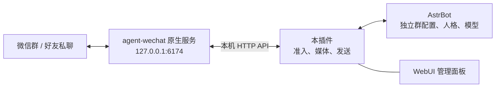

# AstrBot for Personal WeChat

让个人微信小号接入 [AstrBot](https://github.com/AstrBotDevs/AstrBot)：在指定微信群里被 **@** 时回复，与好友私聊，收发文字、图片、语音和文件，并在 AstrBot WebUI 里管理登录状态。

这是社区维护的实验性适配器，微信通信由本机运行的 [agent-wechat](https://github.com/thisnick/agent-wechat) 原生服务完成，插件只负责把它接到 AstrBot。它不是腾讯官方机器人接口，也不是 AstrBot 内置的微信适配器。本仓库只包含 Python 插件、辅助脚本和文档，不包含微信客户端、桥接程序、账号资料或模型密钥。

## 功能

**群聊**

- 只在白名单群里回复明确 @ 机器人的消息；其他群、@全体成员、自己发的消息和历史回放一律忽略。
- 可选的群聊上下文：没有 @ 的群消息也交给 AstrBot 记录，但永远不会被回复，也不能用来执行指令。
- 成员显示为「群昵称(微信 ID)」，改昵称冒充别人也能分辨；手打的「@机器人昵称」可选算作 @。
- 每个群可以在插件设置里单独选择人格，群改名不影响绑定。

**好友私聊**

- 默认回复所有好友，不需要 @；可改为只回复白名单里的好友，或完全关闭私聊。
- 只有桥接标记为私聊的会话才算数，微信团队、公众号等系统会话不会交给模型。

**图片、语音与文件**

- 接收图片、语音、动画表情、引用回复和普通文件；下载后校验长度和 SHA-256。
- 语音交给 AstrBot 的语音转文字；群里的图片和文件在提问者随后 @ 机器人或引用它时附给模型。
- 回复里的图片和文件会上传发送，单个文件上限 50 MiB。

**主动消息与定时提醒**

- 可开放主动发送：AstrBot 定时任务、其他插件和 `send_message_to_user` 工具都能发到白名单群或私聊。
- 在群里 @ 机器人说「每天早上 8 点提醒我……」即可创建提醒，到点会 @ 创建者。

**WebUI 管理面板**

- 在 AstrBot WebUI 的「插件」页打开「微信管理面板」：查看在线状态与今日收发，设备确认登录或扫码登录，浏览会话、搜索通讯录、发测试消息，查看插件日志和桥接事件。
- 桥接令牌只在服务器端使用，面板沿用 WebUI 的登录鉴权。

**稳定性**

- 小号掉线或桥接不可达时，向指定的 AstrBot 会话（如 QQ 私聊）发提醒，恢复后再通知。
- 保存事件游标和已处理消息 ID，发送带幂等键；发送前复查原消息，已撤回的不再回复。

## 工作方式



插件只连接 `http://127.0.0.1:6174`，认证令牌从本地文件读取。Docker 部署时让桥接容器共用 AstrBot 容器的网络，见 [Docker 部署](docs/DOCKER.md)。

## 环境要求

| 组件 | 要求与实测情况 |
| --- | --- |
| AstrBot | 实测 4.29.3（源码运行）和 4.29.4（官方 Docker 镜像，ARM64）；管理面板需要 4.28 及以上的插件页面功能 |
| agent-wechat | 文字收发在 1.1.0 和 1.5.1 上验证；图片、语音、文件功能需要 1.3 及以上，实测 1.5.1 |
| Python | 3.11 及以上，实测 3.12 |
| 聊天模型 | 任何能在 AstrBot 里正常工作的提供商；要让模型看图，需要支持图片输入的模型 |
| 语音转文字 | 在对应的 AstrBot 配置里开启，实测硅基流动 `FunAudioLLM/SenseVoiceSmall`（OpenAI Whisper API 类型） |

其他版本、操作系统或账号状态需要自行验证。

## 开始使用

1. 部署 AstrBot，配置一个能正常回复的聊天模型，记下它的完整提供商 ID。
2. 部署 agent-wechat 桥接，用**单独的微信小号**登录：
   - Docker：[docs/DOCKER.md](docs/DOCKER.md)（推荐，已在生产环境长期运行）
   - 源码运行：[docs/DEPLOYMENT.md](docs/DEPLOYMENT.md)
3. 把小号拉进目标群，查出账号 ID 和群 ID。
4. 停止 AstrBot，安装插件并添加平台配置，再启动。
5. 用另一个微信号在目标群里 @ 小号，或直接私聊它，确认收到回复。

全部配置项见 [配置说明](docs/CONFIGURATION.md)，常见问题见 [故障排查](docs/TROUBLESHOOTING.md)，版本变化见 [更新日志](CHANGELOG.md)。

## 按群选择人格

1. 在 AstrBot 的「人格」页面创建人格并保存。
2. 打开「插件 → AstrBot for Personal WeChat → 配置 → 微信群人格」，在对应群名的卡片里选择人格。
3. 建议保留「切换人格时开始新对话」，然后保存。插件会自动重载，下一条消息生效。

插件为每个群建立独立配置，所以**只改 AstrBot 的默认人格不会影响微信群**，请在这里切换。这里只能管理平台白名单里的群，添加卡片不会授权新群。

## 安全提示

- AstrBot 的本地代码执行（`computer_use_local_permissions`）如果对普通成员开放，任何群成员 @ 机器人、任何好友私聊机器人，都可能让它执行命令、读取含 API 密钥和桥接令牌的配置文件。建议普通成员关闭执行，文件范围限制为 `workspace`。
- 私聊默认对所有好友开放，能加小号为好友的人都能使用机器人。只想服务群时，设置 `friend_whitelist: true` 并留空 `allowed_friends`。
- 个人号的非官方接入可能遇到风控、掉线或协议变更；主动消息发得越多，风险越高。请使用单独的小号，并让群成员知道机器人的用途。

## 限制

- 手机退出或切换走小号时，微信会把桥接踢下线，需要在管理面板重新登录。
- 流式输出会合并后发送。
- 重启前的消息、超过 5 分钟的消息不会回复；模型太慢时，发送前检查可能丢弃结果。
- 游标在交给 AstrBot 之前落盘，优先避免重复回复；进程恰好在落盘后崩溃时可能漏掉一条消息。
- 发送结果不确定时不会自动重发，需要查看桥接发送记录。
- 源码运行方式没有设置开机自启，桥接和 AstrBot 都要保持运行。

## 目录

```text
main.py                       插件入口与平台适配器
panel.py                      管理面板后端路由
views/panel/                  管理面板页面（原生 HTML/CSS/JS）
.astrbot-plugin/i18n/         面板标题等界面文字
metadata.yaml                 插件信息
logo.png                      插件与平台图标
_conf_schema.json             插件配置界面
requirements.txt              运行依赖
scripts/setup_bridge.py       生成本机桥接配置
scripts/wx                    调用独立安装的桥接 CLI
scripts/install_plugin.py     安装插件、备份并追加平台配置
examples/platform.example.json  平台配置示例（占位数据）
tests/                        自动测试
docs/                         部署、Docker、配置与故障排查
CHANGELOG.md                  更新日志
OPEN_SOURCE.md                依赖、参考项目与许可证说明
```

## 开发与测试

测试需要已安装的 AstrBot 及其依赖，使用模拟消息和请求，不登录微信、不发真实消息、不调用收费模型。

```bash
# ASTRBOT_CORE 指向包含 astrbot/ 的源码目录
export ASTRBOT_CORE=/absolute/path/to/AstrBot
export ASTRBOT_PYTHON=/absolute/path/to/venv/bin/python
PYTHONPATH="$ASTRBOT_CORE:$PWD" "$ASTRBOT_PYTHON" -m unittest discover -s tests -v

ruff check .
ruff format --check .
```

也可以在一次性的 AstrBot 官方镜像中运行（AstrBot 会在当前目录创建 `data/`，所以工作目录用 `/tmp`）：

```bash
docker run --rm --network none --read-only --tmpfs /tmp -w /tmp \
  -v "$PWD:/src:ro" -e PYTHONPATH=/src:/AstrBot -e PYTHONDONTWRITEBYTECODE=1 \
  --entrypoint python soulter/astrbot:v4.29.4 -m unittest discover -s /src/tests -v
```

仓库使用 LF 换行，Windows 上请设置 `git config core.autocrlf false`。

## 来源与许可

本项目最初基于 [shuizhaodemumu/astrbot-for-personal-wechat](https://github.com/shuizhaodemumu/astrbot-for-personal-wechat) 的 0.2.0 版本（按群人格与基础的群 @ 回复），之后的 0.3 至 0.9 版本在本仓库独立开发，不再与原仓库同步。原作者的提交和 `v0.2.0` 标签保留在 Git 历史中，感谢原作者的工作。

代码采用 **AGPL-3.0-or-later**，见 [LICENSE](LICENSE)。依赖与参考项目（AstrBot、agent-wechat、aiohttp 等）的用途、版本和许可证核验范围见 [OPEN_SOURCE.md](OPEN_SOURCE.md)。

**本仓库的许可证不覆盖第三方桥接程序。** agent-wechat 未提供可确认的仓库级许可证，本仓库只提供安装指引和链接，不重新分发它。
