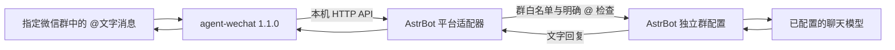

# AstrBot for Personal WeChat

让个人微信测试号在指定微信群中接收 **@自己的文字消息**，交给 AstrBot 调用模型，再把文字回复发回原群。

这是一个社区实验性适配器，使用本机运行的 `agent-wechat` 原生服务；不是腾讯官方机器人接口，也不是 AstrBot 官方内置微信适配器。本仓库提供 Python 插件、配置辅助脚本和部署文档，不包含微信客户端、桥接二进制、账号资料或模型密钥。

> **本仓库是 [shuizhaodemumu/astrbot-for-personal-wechat](https://github.com/shuizhaodemumu/astrbot-for-personal-wechat) 的 fork（0.7.0）**，在 0.2.0 基础上增加：
>
> - **群聊上下文**：平台配置 `context_messages: true` 时，白名单群里没有 @ 的文字也交给 AstrBot，供「群聊上下文感知」记录；这些消息不带 At，不会唤醒模型，也永远不会被回复（插件会丢弃针对它们的回复）。以 `context_skip_prefixes`（默认 `["/"]`）开头的未 @ 文字不转发，群成员不能绕过 @ 执行指令。
> - **群昵称**：`resolve_member_names`（默认开）从桥接读取群成员昵称作为发送者名称，查不到时退回微信 ID；结果缓存一小时。
> - **独立群配置的默认值**：若该群配置继承了 ID 白名单，自动把群会话加入白名单（否则 AstrBot 会静默拦截所有消息）；开启群聊上下文时关闭「主动回复」，并在新建群配置时打开「识别发送者」。
> - **掉线提醒**：插件配置 `alert_sessions` 填 AstrBot 会话 ID（如 `qq:FriendMessage:12345`），小号退出登录或桥接不可达超过 `alert_after_seconds`（默认 120 秒）时发送提醒，恢复后再通知一次。
> - **图片回复（0.4）**：回复中的图片经桥接上传后发送（需要 agent-wechat ≥ 1.3，实测 1.5.1）。`meme_manager` 等插件的补发只在该白名单群最近一次 @ 后 `proactive_window_seconds`（默认 120 秒）内放行，其余主动发送仍被拒绝。
> - **回复体验（0.4）**：`mention_sender` 让回复 @ 提问者；`strip_markdown`（默认开）去掉微信会原样显示的 Markdown；插件配置 `reply_style_hint` 追加到微信群的模型请求，提示不用 Markdown、可用 `[旺柴]` 等微信表情代码、不用 `[微笑]`。
> - **身份识别（0.4.1）**：`show_member_ids`（默认开）把成员显示为「昵称(wxid)」，昵称重名或冒充也能区分；消息 @ 了其他成员时附注被 @ 者；`text_mentions` 让手打的「@机器人群昵称」也算 @（微信只有从成员列表选择时才附带 @ 元数据）。
> - **接收图片和语音（0.5）**：`receive_media`（默认开，需同时开启 `context_messages`）把群里的图片、语音作为群聊上下文交给 AstrBot：图片从桥接下载（优先 standard，原图仍在下载时最多等 15 秒，再退回缩略图），并校验大小与 SHA-256；语音是桥接解码好的 WAV，需要在该群配置里开启 AstrBot 的语音转文字（实测硅基流动 `FunAudioLLM/SenseVoiceSmall`，类型 OpenAI Whisper API）。动画表情记为「[动画表情]」。图片和语音无法 @，所以 @ 机器人时会附上被引用的图片，或提问者 `attach_recent_image_seconds`（默认 120 秒）内自己发的最后一张图（只附一次）。引用回复（type 49）现在当作文字处理，可以 @ 机器人，并注明引用了谁的什么内容。
> - **主动消息与定时提醒（0.6）**：`proactive_messages: true` 时，任何主动发送（AstrBot 定时任务、插件、`send_message_to_user` 工具）都能发到白名单群，不限条数；平台随之声明支持主动消息，AstrBot 会把 `send_message_to_user` 提供给模型。消息链里的 At 组件（如 `mention_user`）会变成真正的微信 @。由群成员创建的定时任务，发出的第一段文字会自动 @ 创建者（消息里已 @ 他人、或创建者不是群成员时除外）。AstrBot 只投递定时任务里经 `send_message_to_user` 发出的内容，模型若只写了最终回复，插件会在 `on_llm_response` 中把这条回复补发到群里（去掉「任务完成、提醒已送达」之类的说明）。在群里 @ 机器人说「每天早上 8 点提醒我……」即可创建，需要开启 `provider_settings.proactive_capability.add_cron_tools`。个人号主动发消息越多，风控风险越高。
> - **好友私聊（0.7）**：默认回复所有好友的私聊，不需要 @。只有桥接标记为 `direct` 的会话才算私聊，微信团队、公众号等系统会话一律忽略。平台配置 `friend_whitelist: true` 后只回复 `allowed_friends` 里的微信 ID（列表为空即关闭私聊）。插件为私聊建一个独立配置「微信 · 私聊」（路由 `<平台ID>:FriendMessage:*`，模型用 `chat_provider_id`，开启「识别发送者」），新建时关闭它从原配置继承的 ID 白名单，否则 AstrBot 会静默拦截所有好友；谁能私聊由上面两项决定。私聊里的文字、引用、图片、语音、动画表情都会单独回复，回复不 @ 对方；语音需要在这个配置里开启语音转文字。定时提醒和主动消息也能发到私聊。插件配置 `private_reply_style_hint` 是私聊用的风格提示。**从旧版本升级后，所有好友都能私聊机器人**；只想服务群的部署请设 `friend_whitelist: true` 并留空 `allowed_friends`。
> - **Docker 部署**：见 [docs/DOCKER.md](docs/DOCKER.md)。
>
> 安全提示：AstrBot 的本地代码执行（`computer_use_local_permissions`）如果对普通成员开放，任何群成员 @ 机器人、任何好友私聊机器人，都可能让它在 AstrBot 所在环境执行命令、读取包含 API key 和桥接令牌的配置文件。建议普通成员关闭执行并把文件范围限制为 `workspace`。

## 工作方式



## 当前能力

- 只接收配置中列出的微信群、明确 @当前微信号的文字消息，以及好友私聊（fork 0.7，可用好友白名单限制）。
- 忽略其他群、系统和公众号会话、自己发送的消息、历史回放和仅 @全体成员的消息。
- 为尚未绑定独立配置的目标群创建 AstrBot 配置，指定聊天模型，取消额外的模型唤醒前缀；不修改其他平台的默认设置。
- 在插件设置中按群名显示允许回复的群，每个群可独立选择人格。
- 保存人格选择后自动重载插件；默认在切换人格时新建对话，旧会话记录保留。
- 自动读取群名，群改名不影响群 ID 绑定；桥接暂时不可用时保留上次名称。
- 保存事件游标和已处理消息 ID；发送请求带幂等键，减少重复回复。
- 发送前再次读取原消息，已撤回的消息不继续回复。
- 桥接只连接 `http://127.0.0.1:6174`，认证令牌从本地文件读取。

## 已验证环境

| 组件 | 实测版本 / 范围 |
| --- | --- |
| 操作系统 | Ubuntu、Linux x86_64；测试主机 glibc 2.43 |
| Python | 3.12 |
| AstrBot | 4.29.3，启动器安装的源码运行实例 |
| agent-wechat | npm `@agent-wechat/cli@1.1.0`，原生 `wx` 服务 |
| aiohttp | 3.14.5 |
| 模型 | 阿里云百炼 OpenAI 兼容接口中的 `qwen-flash` |
| 验证日期 | 2026-10-28 |

实测完成：测试号扫码登录 → 接收指定群 @消息 → AstrBot 调用模型 → 微信服务器接受发送 → 群成员确认收到回复。另有自动测试覆盖准入、去重、撤回检查、发送回执、群配置隔离及人格切换。

以上仅代表这一环境的验证结果。插件依赖 AstrBot 的配置管理接口；其他版本、操作系统或账号状态需要重新验证。

## 开始使用

请按 [Ubuntu 部署步骤](docs/DEPLOYMENT.md) 操作。流程是：

1. 准备 AstrBot，并在它的管理界面配置可正常调用的聊天模型。
2. 独立安装 `agent-wechat` 1.1.0，用本仓库脚本生成私有运行配置。
3. 启动本机桥接服务，用单独的微信测试号扫码确认。
4. 把测试号加入目标群，查询账号 ID、群 ID。
5. 停止 AstrBot，运行安装脚本，指定模型 ID 和群 ID，再启动 AstrBot。
6. 用另一个账号在目标群中 @测试号进行验证。

也可根据 [平台配置示例](examples/platform.example.json) 手动安装。示例中的值全部是占位数据，不能直接运行。

## 按群选择人格（0.2.0）

1. 先在 AstrBot 的 **人格** 页面创建或编辑人格并保存。
2. 进入 **插件 → AstrBot for Personal WeChat → 配置**，展开 **微信群人格**。
3. 找到对应群名的卡片，在 **此群使用的人格** 中选择人格。每个群可以不同。
4. 建议保留 **切换人格时开始新对话**，然后保存。保存会自动重载插件，等待正在生成的群回复完成后应用。下一条消息使用新选择。
5. 用另一个微信号在目标群中 @机器人，询问名字和爱好，验证结果。

首次从 0.1.0 升级，需要复制新增的 `_conf_schema.json` 并重启一次 AstrBot，之后刷新管理页面。日常保存插件设置不需要重启整个实例。

**为什么只改默认人格没有效果？** 插件为每个群创建独立配置，群配置不会跟随默认配置自动修改；已有会话还可能指定了另一个人格。新版保存群选项时会同步该群配置及已有的会话覆盖。不要再通过修改全局默认配置来切换群人格。

**新对话开关的含义：** 仅当实际选择的人格改变时新建对话。普通保存、重启、刷新群名不会反复新建；关闭开关则沿用原历史，只更新人格。旧会话不会删除。仅编辑同一个人格的提示词不会自动新建对话，如仍受旧风格影响，可在会话管理中手动新建。

群名在插件启动或保存时从本机桥接读取，同时显示在 AstrBot 的群配置名称中（`微信 · 群名`）。读取失败会沿用缓存名，首次读取失败则显示群 ID；群名刷新不会改变人格选择。平台 ID 和群 ID 用来精确匹配，通常无需手动修改。

这里只管理平台允许列表中的群；手动添加卡片不会授权新群，已移出允许列表的条目不会应用。删除卡片后会重新发现仍被允许的群，并保留其当前人格。重名群可根据群 ID 区分。不存在的人格不会覆盖当前有效配置，启动日志会给出提示。

## 目录

```text
main.py                       AstrBot 插件入口与平台适配器
metadata.yaml                 插件信息
_conf_schema.json             按群显示与人格选择界面
requirements.txt              运行依赖
scripts/setup_bridge.py       生成本机桥接配置
scripts/wx                    调用独立安装的桥接 CLI
scripts/install_plugin.py     安装插件、备份并追加平台配置
examples/platform.example.json
tests/test_adapter.py         自动测试
docs/DEPLOYMENT.md             部署、启动、停止、升级与移除
docs/TROUBLESHOOTING.md        故障排查
OPEN_SOURCE.md                构建来源、依赖与许可证说明
LICENSE                       本仓库许可证
```

## 限制与行为边界

- 当前只处理文字；不支持图片、语音、文件和主动群发，也不提供自动加群或批量加好友。
- 模型返回的非文字组件不会发送；流式输出会合并后发送。
- 重启后忽略启动前的消息；超过 5 分钟的消息也不会回复。模型处理过慢时，发送前检查可能丢弃结果。
- 游标在交给 AstrBot 之前落盘，优先避免重复回复。进程恰在落盘后崩溃时，可能漏掉该条消息；不承诺恰好一次投递。
- 发送结果不确定时，不会自动重新提交。需要查看桥接发送记录判断实际状态。
- 上游新建的独立账号资料可能标记 `schemaCompatibility: unverified` 或存在待投影批次。登录成功不等于所有接口都兼容；应以实际收发为准。
- 默认没有开机自启。Ubuntu、桥接和 AstrBot 都需要保持运行。
- 使用个人账号的非官方接入可能遇到微信风控、掉线或协议变更。建议使用单独测试号，并让群成员知晓机器人用途。

## 开发与测试

测试需要已安装 AstrBot 及其依赖。不要把真实微信资料用于测试。

```bash
# 在本仓库目录中，用已有 AstrBot 虚拟环境运行。
# ASTRBOT_CORE 指向包含 astrbot/ 的源码目录。
export ASTRBOT_CORE=/absolute/path/to/AstrBot
export ASTRBOT_PYTHON=/absolute/path/to/venv/bin/python
PYTHONPATH="$ASTRBOT_CORE:$PWD" "$ASTRBOT_PYTHON" -m unittest discover -s tests -v

# 在开发环境另行安装 Ruff 后执行：
ruff check .
ruff format --check .
```

自动测试使用模拟消息与请求，不登录微信、不发群消息、不调用收费模型。

## 来源与许可

本仓库代码采用 **AGPL-3.0-or-later**，见 [LICENSE](LICENSE)。主要依赖与参考项目包括 [AstrBot](https://github.com/AstrBotDevs/AstrBot)、[agent-wechat](https://github.com/thisnick/agent-wechat)、[aiohttp](https://github.com/aio-libs/aiohttp)，以及前期评估过的 [astrbot-plugin-agent-wechat](https://github.com/JackZhaoooooo/astrbot-plugin-agent-wechat)。详细用途、版本及许可证核验范围见 [OPEN_SOURCE.md](OPEN_SOURCE.md)。

**本仓库的许可证不覆盖第三方桥接程序。** 部分公开可读的上游仓库未提供可确认的仓库级许可证，不能据此推定可以任意再分发。本仓库只提供安装指引和链接，不重新分发这些项目。
